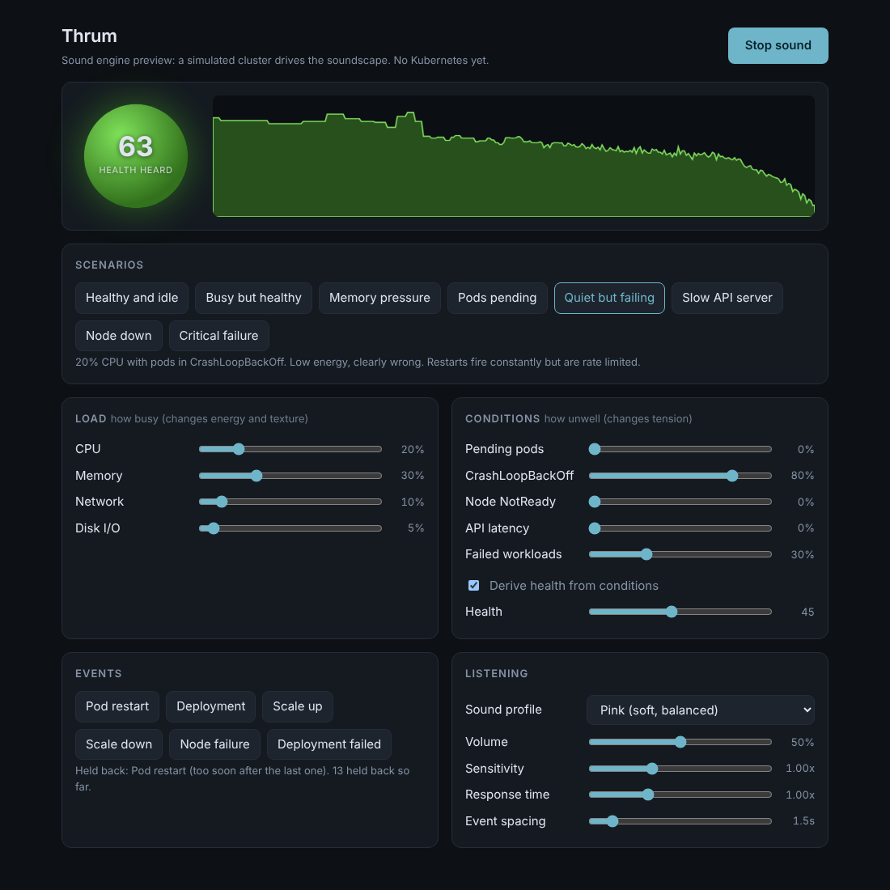
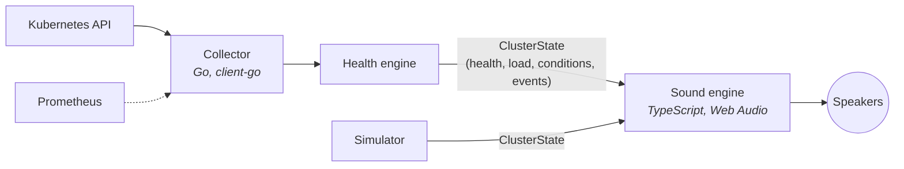

<div align="center">

# Thrum

**Hear the health of your Kubernetes cluster.**

Thrum turns cluster telemetry into a continuous, procedurally generated ambient soundscape.<br>
Healthy sounds peaceful. Trouble sounds like trouble. You never have to look at a dashboard to notice.

[](https://github.com/yeixio/Thrum/actions/workflows/ci.yml)
[](LICENSE)
[](CONTRIBUTING.md)
[](https://github.com/yeixio/Thrum/issues?q=is%3Aissue+is%3Aopen+label%3A%22good+first+issue%22)

[Try it](#try-it) · [How it sounds](#how-it-sounds) · [Architecture](#architecture) · [Roadmap](#roadmap) · [Contributing](#contributing)



</div>

## Why Thrum?

Dashboards need your eyes. Alerts need a threshold someone guessed months ago. Neither tells you how your cluster *feels* right now.

Thrum is a background sense. Leave it playing while you work and you'll learn what normal sounds like. When pods start crash-looping, a node drops out or memory runs short, the soundscape shifts. You notice the way you'd notice a fan spinning up or rain getting heavier: without being interrupted.

> [!NOTE]
> **Thrum is in early development.** The sound engine and a read-only Kubernetes collector work today, in a browser. The desktop app is the next milestone. Now is a great time to get involved and shape how it turns out.

## Principles

- **Never an alarm clock.** Trouble should be recognizable without being punishing. Dissonance has a ceiling, and everything fades rather than jumps.
- **Busy is not unhealthy.** Load changes the energy and texture of the sound. Only real problems add tension.
- **Health is independent of sound.** A health engine produces a normalized state. The sound engine only renders it.
- **Read-only.** Thrum will never need permission to change anything in a cluster.
- **The sound has to be good.** Everything is synthesized procedurally. There are no samples.

## Try it

You need [Node.js](https://nodejs.org/) 20 or newer.

```sh
git clone https://github.com/yeixio/Thrum.git
cd Thrum
npm install
npm run dev
```

Open the printed URL, press **Start sound**, and click through the scenarios. Try **Busy but healthy** next to **Quiet but failing**: the first has more energy, the second is calmer but clearly wrong.

Headphones help. Keep the volume low, the way you'd run it all day.

### Hear a real cluster

With [Go](https://go.dev/) 1.24 or newer and a kubeconfig, start the collector in a second terminal:

```sh
cd collector
go run ./cmd/thrum-collector
```

Then press **Connect to cluster** in the app. The collector only ever reads from your cluster, and serves on localhost only by default. See [collector/README.md](collector/README.md) for options, the health model, and a fake cluster you can use if you don't have one handy.

## How it sounds

Four layers are mixed into one output:

| Layer | What it is | Driven by |
|---|---|---|
| **Base** | Continuous noise in the profile you choose: white, pink, brown, blue, ocean, wind, rain or drone | Your preference, shaped by CPU and memory |
| **Workload** | A brighter band of noise with a gentle pulse | CPU, network, disk |
| **Anomaly** | Tonal voices: consonant when healthy, dissonant when not | Conditions and overall health |
| **Events** | Short signatures, rate limited | Restarts, deployments, scaling, failures |

Each signal has its own voice:

| Signal | What you hear |
|---|---|
| CPU | Intensity |
| Memory | The filter closes in. Near the limit, the sound saturates |
| Network | Pulse rate of the workload layer |
| Disk I/O | Grain and crackle |
| Pending pods | Slow beating against the home pitch |
| CrashLoopBackOff | A minor second |
| Failed workloads | A tritone |
| Node NotReady | The whole tonal center drops and darkens |
| API server latency | Pitch and filter drift |
| Critical health | Slow interruptions in the base layer |

State changes are smoothed with hysteresis and separate attack and decay times, so a brief spike barely registers and recovery settles slowly.

## Architecture



The contract between health and sound is a single normalized `ClusterState`: an overall health score from 0 to 100, load values from 0 to 1, condition severities from 0 to 1, and discrete events. Anything that can produce that shape can drive the sound: the collector, the simulator or a unit test.

```
engine/        Sound engine (TypeScript, Web Audio). No UI, no Kubernetes.
app/           Simulator UI for the engine. Becomes the desktop app.
collector/     Go service that reads cluster state (client-go) and scores health.
deploy/        Read-only RBAC for the collector. A Helm chart is planned.
```

## Roadmap

- [x] **Phase 1: Sound engine.** Procedural noise, layered mixing, smooth transitions between states, simulator UI.
- [x] **Phase 2: Kubernetes integration.** Read kubeconfig, collect telemetry with client-go, build the health model, drive the engine live.
- [ ] **Phase 3: Desktop experience.** Tauri app, system tray, cluster selection, health visuals.
- [ ] **Phase 4: Advanced observability.** Prometheus metrics, multiple clusters each with their own sound identity, anomaly detection, custom profiles.

Have an idea that isn't here? [Start a discussion or open a feature request](https://github.com/yeixio/Thrum/issues/new/choose).

## Contributing

Contributions of every size are welcome: code, sound design, docs, bug reports and ideas.

- New here? Pick a [good first issue](https://github.com/yeixio/Thrum/issues?q=is%3Aissue+is%3Aopen+label%3A%22good+first+issue%22).
- Read [CONTRIBUTING.md](CONTRIBUTING.md) for setup, workflow and conventions.
- Please follow our [Code of Conduct](CODE_OF_CONDUCT.md).
- Found a security problem? See [SECURITY.md](SECURITY.md) and report it privately.

### Development

```sh
npm test            # engine unit tests
npm run typecheck   # type check engine and app
npm run build       # production build of the app

cd collector
go vet ./...
go test -race ./... # collector tests
```

## License

Thrum is released under the [MIT License](LICENSE).
